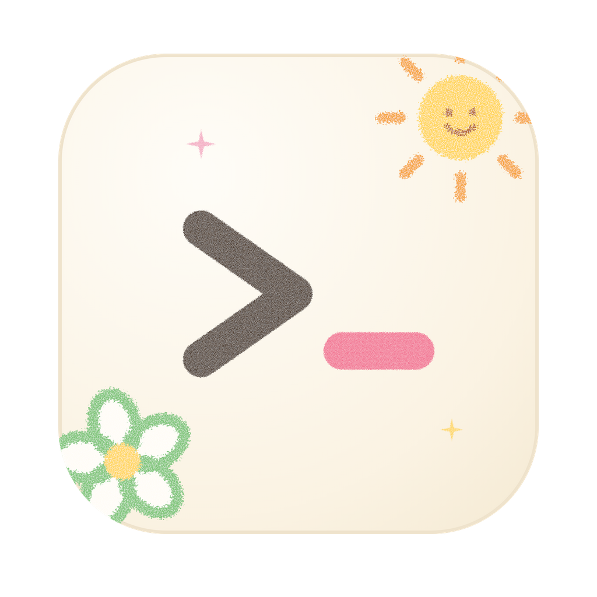
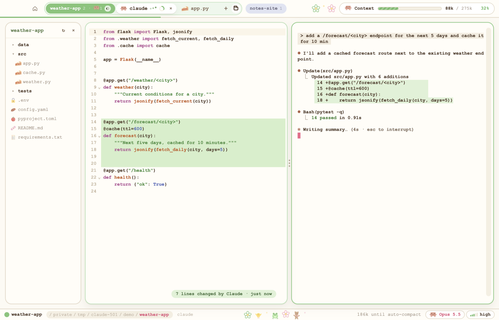
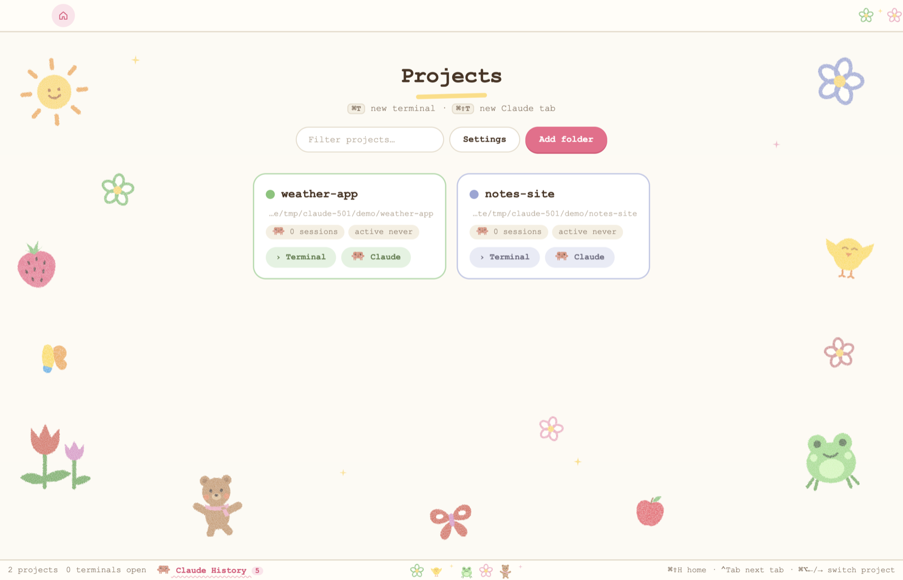

# Personal IDE

A cozy, crayon-styled desktop IDE for working with [Claude Code](https://docs.claude.com/en/docs/claude-code) — terminals grouped by project, a live context-window meter, agent status, and a side-by-side file editor, all on off-white "paper" with hand-drawn doodles.

> **Unofficial.** This is a personal side project. It is not made by, affiliated with, or endorsed by Anthropic. "Claude" and "Claude Code" are Anthropic's names; this app simply runs the `claude` CLI you already have installed.

<p align="center"></p>



<details>
<summary>Home page</summary>



</details>

<sub>Screenshots show a made-up demo project and an example session.</sub>

## Features

**Projects & terminals**
- Home page of project folders (git branch, Claude session count, last activity); suggestions from your Claude Code history.
- Terminals grouped by project in a pill-shaped tab strip; collapse groups, drag to reorder, double-click to rename.
- Each terminal floats as a card outlined in its project's color, with a chunky scrollbar and a "↓ latest" button.
- Live working-directory breadcrumb in the bottom bar (follows `cd`, click a segment to open it in Finder).

**Made for Claude Code**
- **Context meter** — tokens used vs. the auto-compaction point, learned from your own past compactions.
- **Agent status** — working / needs you / done on every Claude tab, with project roll-ups, Dock badge and notifications.
- **Model & effort pills** — see and switch `/model` and `/effort` from the bottom bar.
- Shift+Enter inserts a newline; drop files onto a terminal to paste their paths.
- Terminals start from a clean environment, so `claude` never inherits stray settings from whatever launched the app.

**File editor** (CodeMirror 6)
- File tree (⌘B), quick open (⌘P), save (⌘S); Python, Markdown (raw text), JS/TS, JSON, YAML, HTML, CSS highlighting.
- Side-by-side split with a Claude tab (⌘\\), resizable.
- When Claude edits an open file it reloads live and the changed lines glow; unsaved edits are never silently overwritten.
- Crayon file icons with puns: `.py` 🥧 pie, `.md` 🩹 band-aid, `.yaml` 🍠 yam, `.sh` 🐚 seashell, `.ts` teacup, `.rs` crab, …

**Look & feel** — light paper theme, bold Courier, a pastel crayon palette, and original crayon doodles (flowers, sun, chick, frog, teddy bear…) that pause when the window is in the background (~0.2% idle CPU).

## Requirements

- macOS (Apple Silicon or Intel), [Node.js](https://nodejs.org) 18+
- Xcode Command Line Tools (`xcode-select --install`) — needed to build the terminal engine (`node-pty`)
- The [Claude Code CLI](https://docs.claude.com/en/docs/claude-code) on your `PATH` (`claude`)

## Run it

```bash
git clone https://github.com/abbydaeun/personal-ide.git
cd personal-ide
npm install        # also rebuilds node-pty for Electron
npm start
```

### Install as a Mac app

```bash
npm run install-app
```

Builds `Claude IDE.app`, installs it to `~/Applications`, and adds a Desktop shortcut. Run it again after pulling changes to update.

## Shortcuts

| Keys | Action |
|---|---|
| ⌘T / ⌘⇧T | New terminal / new Claude tab in the current project |
| ⌘W | Close tab |
| ⌃Tab, ⌘⇧] / ⌘⇧[ | Next / previous tab |
| ⌘1–9 | Tab N in the current project (⌘9 = last) |
| ⌘⌥← / → | Previous / next project |
| ⌘⇧H | Home |
| ⌘P / ⌘B / ⌘S / ⌘\\ | Quick open / file tree / save / split with terminal |

## How it works

- **Context meter:** reads Claude Code's session transcripts in `~/.claude/projects/` and sums the latest assistant turn's input + cache + output tokens; compaction events reset it and calibrate the threshold.
- **Agent status:** reads the bottom of each Claude screen (e.g. "esc to interrupt", permission prompts).
- **Your data stays local:** the project list and settings live in `~/Library/Application Support/claude-ide/`; nothing is sent anywhere.

## Project layout

| Path | What |
|---|---|
| `main.js` | Electron main: window, terminals (node-pty), status polling, project-confined file access |
| `preload.js` | Safe bridge between main and the UI |
| `src/claudeTracker.js` | Transcript parsing, session↔tab matching, compaction calibration |
| `renderer/` | UI: `app.js` (tabs, home, meter, status), `files.js` (editor, tree, split), `doodles.js` (crayon art), `bgfilter.js`, `styles.css` |
| `src/editor-entry.js` | CodeMirror bundle source → `renderer/vendor/codemirror.js` (`npm run build:editor`) |
| `scripts/` | `package.js` (build/install the app), `make-icon.js`, `smoke.js` (scripted UI test) |

## License

[MIT](LICENSE)
